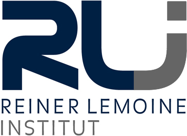

# SimBEV

Simulation of electric vehicle charging demand.

## Documentation

The full documentation can be found [here](https://simbev.readthedocs.io/en/latest/)

## Installation

### Install using pip

First, clone via SSH using

    git clone git@github.com:rl-institut/simbev.git /local/path/to/simbev/

Make sure you have Python >= 3.8 installed, let's create a virtual env:

    virtualenv --python=python3.8 simbev
    source simbev/bin/activate

Install package with

    pip install -e /local/path/to/simbev/

### Install using conda

Make sure you have conda installed, e.g. miniconda. Then create the env:
    
    conda env create -n simbev -f /local/path/to/simbev/environment.yml
    conda activate simbev

## Run simBEV

### Get the data
If you want to run SimBEV in the mode using probabilities, a data set is available on [Zenodo](https://doi.org/10.5281/zenodo.24108280).
It contains the folders `probability_private` (private passenger cars, based on MiD 2023) and
`probability_commercial` (commercial vehicles, based on KiD 2010), which have to be placed in the directory `data`.
The data set for SimBEV versions before 2.1.0 (based on MiD 2017) is available [here](https://doi.org/10.5281/zenodo.7609683).

### Create a scenario
- You can use a default scenario or define a custom one in the directory `scenarios`
- Run simbev with the desired scenario: `python -m simbev path/to/config`
  (defaults to `python -m simbev scenarios/default/configs/default.cfg`)
- Results are created in the subdirectory `results` in the scenario directory

### Set parameters for your scenario

Select regio-type for the mobility characteristics:
- regiotypes:
Ländliche Regionen
LR_Klein - Kleinstädtischer, dörflicher Raum
LR_Mitte - Mittelstädte, städtischer Raum
LR_Zentr - Zentrale Stadt
Stadtregionen
SR_Klein - Kleinstädtischer, dörflicher Raum
SR_Mitte - Mittelstädte, städtischer Raum
SR_Gross - Regiopolen, Großstädte
SR_Metro - Metropole

Change vehicle configuration
- battery capacity
- charging power (slow and fast)
- consumption

Decide how many vehicles should be simulated
- note: more than 5000 vehicles of one type in one region is not necessary, if you want to analyze more, scale it accordingly

## License

see [LICENSE](LICENSE)
